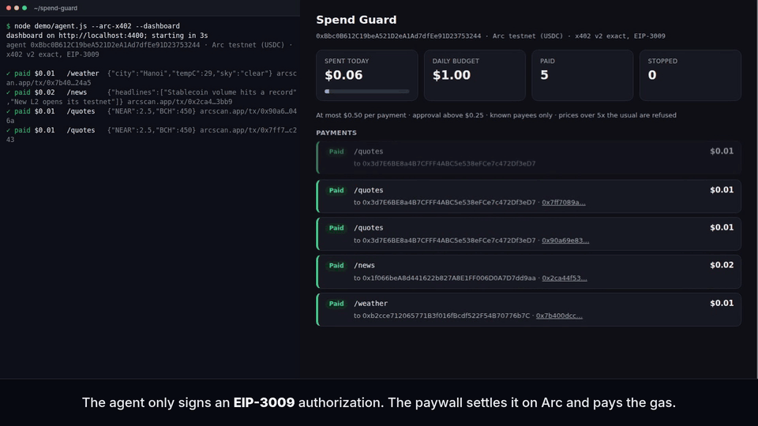
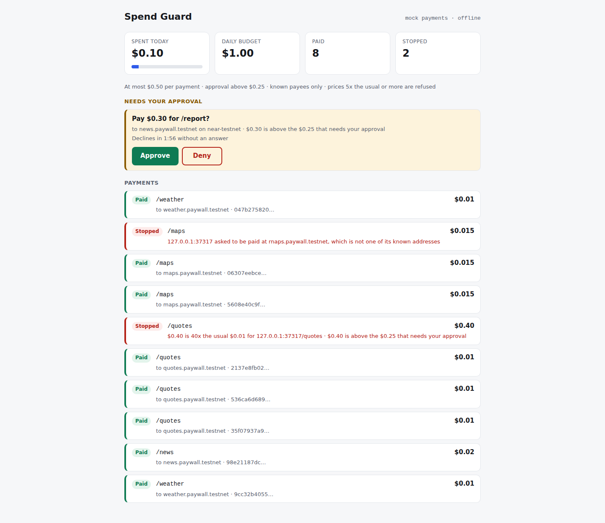

# Spend Guard

**A spending guard for AI agents that pay for APIs in USDC and NEAR.**



A real run on Arc testnet with x402 `exact` (`node demo/agent.js --arc-x402 --dashboard`), trimmed and sped up: the guard refuses a 40x price spike and a swapped payout address before anything is signed, and a $0.30 payment goes out only after a person clicks Approve on the dashboard.

Agents are starting to pay per call over HTTP 402: the server answers `402 Payment Required` with a price, the agent pays and gets the data (the [x402](https://www.x402.org/) protocol). An agent that can pay can also be talked into paying: a prompt injection, a retry loop, or a paywall that raises its price or swaps its payout address. Spend Guard sits between the agent and its money. Every payment is checked against budgets, a payee allowlist and the endpoint's usual price, and anything unusual waits for a person to approve it. All of this happens before any USDC leaves and before any authorization is signed. It pays on Circle's Arc testnet by plain USDC transfer, by x402 `exact` (EIP-3009) and by Circle Gateway nanopayments, from a local key, and in NEAR on NEAR testnet. A rail for Circle developer-controlled wallets is tested offline only. Claude and other MCP clients can use it as an MCP server.

Status: testnet only, not audited. On npm as [`@vulinh1704/spend-guard`](https://www.npmjs.com/package/@vulinh1704/spend-guard) and in the official MCP Registry as `io.github.vulinh1704/spend-guard`. MIT licensed.

Built for [NEAR HACKATHON](https://nearhackathon.com) (19 Oct–14 Nov 2026). What was built in the window, the submission tag and how to run the NEAR testnet demo are in [Built for NEAR HACKATHON](#built-for-near-hackathon).

## Quickstart (1 minute, no keys)

You need git and Node 22.22.2 or later. No keys and no wallet: the payments are mocked, and nothing leaves your machine after the install.

```
git clone https://github.com/vulinh1704/spend-guard
cd spend-guard
npm ci
node demo/agent.js                       # a scripted agent against a demo paywall that turns bad
node demo/agent.js --dashboard           # the same run, paced, with the live page on http://localhost:4400
```

With `--dashboard`, open http://localhost:4400 while it runs. The $0.30 `/report` waits there for Approve or Deny, and is declined after 120 seconds without an answer. The page stays up until you press Ctrl+C. If 4400 is taken, the demo takes a free port and prints it; `DASHBOARD_PORT` picks another.

## What it stops

The demo paywall behaves for a few calls and then turns bad. `/quotes` raises its price 40x, and `/maps` asks to be paid at a look-alike address. `/report` stays honest but costs more than the agent may pay without asking. This is the offline demo, `node demo/agent.js`:

```
✓ paid $0.01   /weather  {"city":"Hanoi","tempC":29,"sky":"clear"}
✓ paid $0.02   /news     {"headlines":["Stablecoin volume hits a record","New L2 opens its testnet"]}
✓ paid $0.01   /quotes   {"NEAR":2.5,"BCH":450}
✓ paid $0.01   /quotes   {"NEAR":2.5,"BCH":450}
✓ paid $0.01   /quotes   {"NEAR":2.5,"BCH":450}
✗ denied /quotes   $0.40 is 40x the usual $0.01 for 127.0.0.1:33955/quotes; $0.40 is above the $0.25 that needs your approval
✓ paid $0.015  /maps     {"route":"Hoan Kiem → My Dinh","km":11.2}
✓ paid $0.015  /maps     {"route":"Hoan Kiem → My Dinh","km":11.2}
✗ denied /maps     127.0.0.1:33955 asked to be paid at rnaps.paywall.testnet, which is not one of its known addresses
✓ paid $0.01   /weather  {"city":"Hanoi","tempC":29,"sky":"clear"}
  ? asks you: $0.30 is above the $0.25 that needs your approval → no
✗ declined /report   $0.30 is above the $0.25 that needs your approval

spent today $0.10 of $1.00; 3 payments stopped
```

The same run on Arc testnet with x402 `exact` (`node demo/agent.js --arc-x402`, 31 Oct 2026) paid in real test USDC. The agent only signed. The paywall settled each signature on chain and paid the gas, so the agent's balance fell by exactly the $0.10 it spent:

```
agent 0xBbc0B612C19beA521D2eA1Ad7dfEe91D23753244 · Arc testnet (USDC) · x402 v2 exact, EIP-3009
✓ paid $0.01   /weather  … https://testnet.arcscan.app/tx/0x92414aea1d896cd7ebd032c85ca32a84764d743931e61f4474a92f434a61fae3
✗ denied /maps     … asked to be paid at 0xF870cC7D7c258Cc856197fB6C3C819AD6Bb324b5, which is not one of its known addresses
agent wallet $17.999436 → $17.899436 USDC (-$0.10)
```

| Rule | What it catches |
|---|---|
| A per-payment limit, a daily budget and a per-call cap for each service | overpriced calls; a loop's total stops at the daily budget |
| Payee allowlist per service | a paywall that starts asking to be paid somewhere else |
| Price spike against the endpoint's usual price | a sudden 5x, 40x, 1000x |
| Human approval above a threshold, or for an unknown service | large payments, a payment to a host the policy doesn't list, such as one an injected page pointed the agent to |
| One decision at a time (with a ledger file, across processes too) | parallel tool calls racing the daily budget |

Every decision, paid or not, is recorded with its reasons. The rules and their exact messages are in [docs/policy.md](docs/policy.md).

## How it works

```
agent ── payingFetch(url) ──► paywall: 402 + offer (PAYMENT-REQUIRED)
              │
              ▼
            Guard ── policy: budgets, payees, usual price ── ledger
              │  └─ flagged? ask the person on the dashboard
              ▼
            Rail ── USDC transfer · EIP-3009 signature · Gateway authorization · Circle wallet
              │
payingFetch ──► paywall: PAYMENT-SIGNATURE ──► 200 + data + PAYMENT-RESPONSE (settlement)
```

The guard decides before a rail moves money or signs anything. A rail that signs uses the payee and amount the guard approved, never the paywall's own numbers, and it pins the chain and token it signs for. More in [docs/architecture.md](docs/architecture.md).

## Rails

| Rail | How the agent pays | Status |
|---|---|---|
| Arc USDC transfer (`--arc`) | ERC-20 `transfer` from the agent's key. The paywall checks the receipt's USDC `Transfer` event. | Works on Arc testnet, for example [this payment](https://testnet.arcscan.app/tx/0xf5f21167bc08705aba8a1c4c79278552ef83a7373634f3fcdc167fa0220c4952). |
| x402 `exact` on Arc (`--arc-x402`) | Signs an EIP-3009 `transferWithAuthorization` for USDC. The paywall verifies and settles it, and pays the gas. | Works on Arc testnet. The demo paywall is its own settler. |
| Circle Gateway (`--gateway`) | Signs a Gateway authorization against USDC deposited once in Circle's Gateway Wallet. Circle settles the payments in batches. | Works on Arc testnet, with no Circle account or API key. One earlier run's payments landed in [one batch transaction](https://testnet.arcscan.app/tx/0x52319ff9e84fa8fa67b2c716e4e1918775d66c3823a489980010e670d75f3833). |
| Circle Wallets | A Circle developer-controlled wallet transfers or signs, so no private key sits in the agent's process. | Tested offline against Circle's SDK. Not run against Circle yet, because it needs your Circle account ([setup](docs/circle-wallets.md)). |
| NEAR testnet (`--near`) | Native NEAR transfer. | Works on NEAR testnet. |
| Mock | Nothing moves. | Tests and the offline demo. |
| Bitcoin Cash, Concordium | | Planned. |

Details for each rail are in [docs/rails.md](docs/rails.md).

### x402 v2 and the `exact` scheme (EIP-3009)

`payingFetch` speaks x402 v2. It reads the offer from the `PAYMENT-REQUIRED` header, and still reads v1 JSON bodies. For an `exact` offer in USDC on Arc that names the token's EIP-712 domain, the agent signs a `transferWithAuthorization` and sends no transaction. The signature is the payment, so the guard decides first and counts it as spent when it is signed. Each signature is for the approved payee and amount only, has a fresh random nonce, and is valid for at most 120 seconds. Offers for another chain (the same key works on Arc mainnet), another token, or Permit2 and escrow flows are refused before anything is signed, with the reason.

```
node scripts/arc-testnet-wallet.js       # agent key and demo payees in .env; fund the agent at https://faucet.circle.com (Arc Testnet)
node scripts/arc-facilitator.js          # the demo paywall's settling key, topped up with a little test USDC for gas
node demo/agent.js --arc-x402 --dashboard
```

### Circle Gateway nanopayments

The agent deposits USDC into Circle's Gateway Wallet once. After that each call is an off-chain authorization: no gas and no transaction per call, so a $0.01 call costs $0.01. Circle settles the payments on Arc in batches a few minutes later. A Gateway authorization stays valid for at least 7 days, so the guard decides before it is signed. The rail also signs nothing the deposit can't cover, counting what is signed but not settled yet.

```
node scripts/gateway-deposit.js 1        # approve and deposit 1 test USDC (two Arc transactions)
node demo/agent.js --gateway --dashboard # nanopayments to an x402 v2 seller that settles each one with Circle
node scripts/gateway-status.js           # Gateway balance, and each payment's batch transaction on Arc
```

### Circle Wallets

With `CircleWalletRail`, Circle holds the key (MPC) and signs when asked. The agent's process has a testnet API key and an entity secret, but no private key, and Spend Guard still checks every payment before Circle is asked to send or sign. Circle's own controls (custody, screening, `DENIED`) still apply after the guard says yes. [docs/circle-wallets.md](docs/circle-wallets.md) explains the setup, which needs your own Circle developer account, and how the two layers fit together.

## Use it from Claude or any MCP client

`spend-guard mcp` serves the guard over stdio and gives an MCP client three tools:

- `pay_and_fetch` fetches a URL and pays its x402 paywall through the guard.
- `spending_status` and `spending_policy` are read-only views of the budget, recent payments and the rules.

There is no tool to approve a payment or to change the policy. Payments the policy flags wait for you on the dashboard. They are declined after 55 seconds without an answer, and a call the client cancels never pays.

The config goes in `.mcp.json` (Claude Code, project scope) or `claude_desktop_config.json` (Claude Desktop). Cursor and other clients take the same `mcpServers` shape.

From npm. The default `mock` rail pays nothing, so this is a safe first try:

```json
{
  "mcpServers": {
    "spend-guard": {
      "command": "npx",
      "args": ["-y", "@vulinh1704/spend-guard", "mcp"],
      "env": { "SPEND_GUARD_POLICY": "/abs/path/policy.json" }
    }
  }
}
```

The mock rail pretends to pay on `near-testnet`, so this policy must allow that network: list `"networks": ["near-testnet"]`, or leave `networks` out and the server allows the networks of the rails it runs. A policy that lists only Arc networks leaves the mock rail nothing it may pay. To have something to pay, run the demo paywall from a clone, `node demo/paid-api.js`, and ask the agent to fetch http://localhost:4402/weather. [`demo/mcp-policy.json`](demo/mcp-policy.json) is a mock policy that knows its payees.

From a clone, and for the rails that pay. Node reads the keys from `.env` with `--env-file`, which npx can't pass on, so they stay out of the client's config:

```json
{
  "mcpServers": {
    "spend-guard": {
      "command": "node",
      "args": ["--env-file=/abs/path/spend-guard/.env", "/abs/path/spend-guard/bin/spend-guard.js", "mcp"],
      "env": { "SPEND_GUARD_POLICY": "/abs/path/policy.json", "SPEND_GUARD_RAILS": "arc,gateway" }
    }
  }
}
```

Or in Claude Code: `claude mcp add spend-guard -- npx -y @vulinh1704/spend-guard mcp`, or from a clone `claude mcp add spend-guard --env SPEND_GUARD_POLICY=/abs/path/policy.json --env SPEND_GUARD_RAILS=arc -- node --env-file=/abs/path/spend-guard/.env /abs/path/spend-guard/bin/spend-guard.js mcp`

A `policy.json` for the `arc,gateway` config. Its `networks` are the ones those two rails pay on; with other rails, list theirs or leave `networks` out:

```json
{ "networks": ["arc-testnet", "arc-testnet-gateway"], "dailyUsd": 1, "perPaymentUsd": 0.5, "askAboveUsd": 0.25, "spikeRatio": 5, "unknownService": "ask",
  "services": { "api.example.com": { "payTo": ["0xPayeeAddress"], "maxUsd": 0.1 } } }
```

| Variable | Meaning |
|---|---|
| `SPEND_GUARD_RAILS` | `mock` (default, pays nothing), `near`, `arc`, `gateway`, or a comma list |
| `SPEND_GUARD_POLICY` | the policy file. Without one, every service is unknown, so every payment asks you. Without `networks` in it, the networks of the rails you run are allowed. |
| `SPEND_GUARD_LEDGER` | decisions file, read back on start, so a restart keeps today's spend. Servers on one file share one budget. Default `~/.spend-guard/ledger.jsonl`; `off` keeps it in memory. |
| `SPEND_GUARD_DASHBOARD_PORT` | dashboard port on 127.0.0.1, default 4400; `0` picks a free one. If it is taken, a free one is used and named on stderr. `off` means no dashboard, and flagged payments are declined. |
| `SPEND_GUARD_APPROVAL_TIMEOUT` | seconds a payment waits for you (default 55). Raise it together with your client's tool timeout. |
| `SPEND_GUARD_MOCK_NETWORK` | the network the `mock` rail pretends to pay on (default `near-testnet`, which the demo paywall asks for) |
| `ARC_PRIVATE_KEY` | for `arc` and `gateway`. Testnet keys only. |
| `NEAR_ACCOUNT_ID`, `NEAR_PRIVATE_KEY` | for `near`. Testnet keys only. |

Keys come from `.env` through `--env-file` and never go in the client's config. Run the paying agent without shell or browser tools: with them it could read `.env`, or press Approve itself.

Try it without a model: `node scripts/mcp-demo.js` (mock), or `node scripts/mcp-demo.js --arc` (real test USDC on Arc).

## Approve on the dashboard



The dashboard is a live page on `http://localhost:4400`. It shows the budget, every decision with its reasons and a link to its transaction, and an Approve or Deny card with a countdown for each flagged payment. It listens on 127.0.0.1 only and answers to localhost names only, and an approval is accepted only from the page itself (same Origin, loopback peer, JSON body). It has light and dark themes and a responsive layout (it answers on localhost only, so approving from a phone is on the roadmap), and is checked with [Mantis](https://github.com/vulinh1704/mantis) (`scripts/check-dashboard.sh`: 0 errors and 0 warnings on mobile and desktop, light and dark).

```
node demo/agent.js --dashboard           # the offline demo, paced for watching; /report waits for your answer
```

## Install and test

```
npm ci
npm test                                 # 204 tests, offline: no network, no keys
(cd contracts/near-guard && cargo test)  # 22 contract tests, offline (Rust 1.95+)
node demo/agent.js                       # offline demo, mock payments
```

You need Node 22.22.2 or later, because `near-api-js` 7 does (Circle's SDK needs Node 22). The testnet demos read keys from `.env`, which is git-ignored, and the setup scripts write them there. Testnet tokens have no value. Never point the scripts at mainnet.

| Demo | Needs |
|---|---|
| `node demo/agent.js --arc` | `node scripts/arc-testnet-wallet.js`, then test USDC from https://faucet.circle.com |
| `node demo/agent.js --arc-x402` | the above, plus `node scripts/arc-facilitator.js` |
| `node demo/agent.js --gateway` | the above, plus `node scripts/gateway-deposit.js 1` |
| `node demo/agent.js --near` | `node scripts/near-testnet-account.js` and `node scripts/near-demo-payees.js` |
| `node demo/agent.js --near-guard` | the above, plus `node scripts/near-guard-deploy.js` |

Add `--dashboard` to any of them to watch on the live page.

## Use it as a library

```js
import { Guard, payingFetch } from '@vulinh1704/spend-guard';
import { ArcRail } from '@vulinh1704/spend-guard/rails/arc';
import { GatewayRail } from '@vulinh1704/spend-guard/rails/gateway';

const guard = new Guard({
  policy: {
    networks: ['arc-testnet', 'arc-testnet-gateway'],
    dailyUsd: 5, perPaymentUsd: 1, askAboveUsd: 0.25, spikeRatio: 5, unknownService: 'ask',
    services: { 'api.example.com': { payTo: ['0xPayeeAddress'], maxUsd: 0.5 } },
  },
  rails: [new ArcRail({ privateKey: process.env.ARC_PRIVATE_KEY }), new GatewayRail({ privateKey: process.env.ARC_PRIVATE_KEY })],
  approve: async (intent, verdict) => askTheHuman(verdict.reasons), // never the model
});

const res = await payingFetch(guard, 'https://api.example.com/data'); // pays a 402 through the guard
```

`payingFetch` throws `GuardRefused` with the reasons when the guard says no. `Approvals` is the queue the dashboard and the MCP server use for `approve`. Install it with `npm install @vulinh1704/spend-guard` (Node 22.22.2 or later).

## Built for NEAR HACKATHON

Spend Guard is my entry to [NEAR HACKATHON](https://nearhackathon.com), in the tracks AI Security & Defense (`security`) and Agent Economy (`agents`).

- **Window.** Code written from the announcement on 19 Oct 2026 counts. The hackathon runs 1–14 Nov 2026, and submissions close on 14 Nov 2026 at 23:59 UTC.
- **All of this repository is from the window.** Its first commit, [`90d376b`](https://github.com/vulinh1704/spend-guard/commit/90d376b), is from 30 Oct 2026. There is no earlier code here, so there is no `pre-hackathon` tag, and the diff is the whole repository. Check it with `git log --reverse --format='%h %ad %s' --date=short | head -3`.
- **Submission tag:** [`near-hackathon-2026`](https://github.com/vulinh1704/spend-guard/tree/near-hackathon-2026) is the state I submitted ([its commits](https://github.com/vulinh1704/spend-guard/commits/near-hackathon-2026)).
- **AI assistance (rule Q-005).** Parts of the code, tests and docs were written with an AI coding assistant (Claude Code). I reviewed and tested every change.
- **Demo:** video VIDEO_URL_TODO, demo post on X DEMO_POST_URL_TODO.

### What NEAR does here

The agent pays in native NEAR on testnet in one of two ways: from its own account (`--near`), or through a guard contract that holds the NEAR, where the agent has only a function-call key for `pay()` (`--near-guard`). Either way, the paywall reads every payment back from the chain before it serves the data.

- `src/rails/near.js`: `NearRail` sends a NEAR transfer only for a payment the guard has already approved, to the approved account and for the approved amount. It keeps the hash of the transaction it signed, so a transfer that was sent but lost in an RPC timeout is recorded as `unconfirmed` and still counts against the budget. `checkNearPayment` is the paywall's side: it fetches the transaction with all its receipts from NEAR RPC (`EXPERIMENTAL_tx_status`) and adds up the transfers to the expected account that succeeded, which must come to at least the price.
- Named accounts make the payee check easy to read. The demo paywall is `sg-paywall-<id>.testnet`, with one sub-account per service (`weather.`, `news.`, `quotes.`, `maps.`) and the look-alike `rnaps.` that the bad `/maps` endpoint switches to. `scripts/near-testnet-account.js` and `scripts/near-demo-payees.js` create them on testnet.
- `node demo/agent.js --near` runs the test agent against that paywall with real testnet transfers and links each one on testnet.nearblocks.io. `spend-guard mcp` runs the same rail with `SPEND_GUARD_RAILS=near`.
- `contracts/near-guard` is a Rust contract (near-sdk 5) that holds the agent's NEAR. Its `pay(receiver, amount)` pays only accounts on the owner's allowlist, at most a per-payment cap, and at most a daily cap per UTC day. Changing the allowlist or the caps, pausing and withdrawing are for the owner only, and each needs 1 yoctoNEAR attached, which a function-call key can't attach. `NearGuardRail` in `src/rails/near.js` pays through it with the agent's function-call key, which may call `pay` on the guard account and nothing else. The built wasm and its sha256 are committed (`contracts/near-guard/res`).
- `scripts/near-guard-deploy.js` creates `guard.<your account>`, deploys that wasm, sets the policy and adds the agent's key. `scripts/near-guard-stolen-key.js` then plays someone who stole that key and goes straight to the chain. The contract refuses the look-alike payee and both caps, and NEAR itself rejects a plain transfer, `withdraw` and adding a key. The recorded run is in [docs/near-testnet-run.md](docs/near-testnet-run.md#the-guard-contract-deployed-10-nov-2026-0346-utc), on `guard.spend-guard-bbeb82.testnet`.
- `test/near.test.js` covers both rails and the paywall check offline, and `cargo test` in `contracts/near-guard` runs the contract's 22 unit tests.
- `node scripts/near-verify.js` checks the recorded testnet runs with no key and no account. It reads each transaction in [docs/near-testnet-run.md](docs/near-testnet-run.md) from a public archival RPC and runs the paywall's check on it. It checks that the guard's refusals failed with the contract's own reason. It also checks that the code on `guard.spend-guard-bbeb82.testnet` is the committed wasm, and that the agent's key there may only call `pay`.

**Where it sits.** NEAR's Agent Connect gives an agent "its own account on NEAR Intents, acting within rules its owner signs", and other projects put spending caps in a contract. Rules like these, and Spend Guard's own guard contract, decide from the payment itself. The off-chain guard decides earlier, at the HTTP 402, from what only the client sees there: the endpoint's usual price, the payee accounts each service may use, and a person's Approve for anything large or unknown. The two layers fit together. The contract bounds what a stolen key can spend, and the off-chain guard stops a bad payment that is still under the cap.

Also built in the window, and not specific to NEAR: the guard itself (policy, ledger, approvals), the x402 client, the dashboard, the MCP server and the npm package. The rails for USDC on Circle's Arc testnet (plain transfer, x402 `exact`, Circle Gateway, Circle Wallets) were built in the same window for Circle's chain. They are not part of the NEAR integration.

Libraries: `near-api-js` (the NEAR rails and scripts), `near-sdk` (the guard contract, built with `cargo-near`), `viem` (EVM address checks and the Arc rails), Circle's `@circle-fin/developer-controlled-wallets` and `@circle-fin/x402-batching` (Arc rails only), and `@modelcontextprotocol/sdk` (tests and the MCP demo script only). [Mantis](https://github.com/vulinh1704/mantis), my own UI checker and a separate project, checks the dashboard's layout in `scripts/check-dashboard.sh`. It is not shipped and is not part of this entry.

### Run the NEAR testnet demo

You need git and Node 22.22.2 or later. Testnet NEAR has no value. Never use a mainnet key here.

1. Get the code: `git clone https://github.com/vulinh1704/spend-guard && cd spend-guard && git checkout near-hackathon-2026 && npm ci`
2. Offline first, with no keys. `npm test` → 204 tests pass. `node demo/agent.js` → 8 paid calls, a 40x price spike denied, a payment to `rnaps.paywall.testnet` denied, the $0.30 `/report` declined, and `spent today $0.10 of $1.00; 3 payments stopped`.
3. Check the recorded runs, still with no keys: `node scripts/near-verify.js` → one `✓` line per check and `every check passed`. The checks are the transfers of the recorded runs, each read from the chain, and the look-alike `rnaps.sg-paywall-25135e.testnet` still holding only the 0.05 NEAR it was created with. They also cover the guard contract's three refusals, its code hash, its policy and the agent key's permission. The contract's own tests need Rust 1.95 or later: `cd contracts/near-guard && cargo test` → 22 tests pass.
4. `node scripts/near-testnet-account.js` → `created spend-guard-<id>.testnet; key written to .env`. It refuses to run if `.env` already exists.
5. `node scripts/near-demo-payees.js` → five lines `created <name>.sg-paywall-<id>.testnet`, the last one for `rnaps`.
6. `node demo/agent.js --near --dashboard`, then open http://localhost:4400 →
   - `✓ paid $0.01 /weather … https://testnet.nearblocks.io/txns/<hash>`: a real transfer of 0.004 testnet NEAR from your agent account to `weather.sg-paywall-<id>.testnet`. Prices are set in dollars and converted at a fixed $2.50 per NEAR.
   - `✗ denied /quotes $0.40 is 40x the usual $0.01 …`: refused before signing, so there is no transaction.
   - `✗ denied /maps … asked to be paid at rnaps.sg-paywall-<id>.testnet, which is not one of its known addresses`: refused before signing. The `rnaps.` account still holds only the 0.05 NEAR it was created with.
   - The $0.30 `/report` waits on the dashboard for Approve or Deny, and is declined after 120 seconds. Approve sends 0.12 testnet NEAR.
   - The last line, `agent account <before> → <after> NEAR (…: 0.040000 paid, … gas)`, reads the agent account's balance from the chain before and after the run, and splits the difference into the payments and the gas.
   - Press Ctrl+C to stop the dashboard.
7. `node scripts/near-guard-deploy.js` → `deployed contracts/near-guard/res/spend_guard_near.wasm (sha256 5zH4VraYSfVk5BWgQciXiTMZb4P51oiDFSa4VNjwqRTM) …`, the allowlist without `rnaps.`, the caps (0.15 NEAR per payment, 0.25 NEAR a day), and the agent's key, written to `.env`. It moves 2.5 testnet NEAR from your account into the guard, and most of that pays for the contract's storage.
8. `node demo/agent.js --near-guard` → the same calls and refusals as step 6, but each payment is a `pay()` call on the guard. The paywall finds the transfer among the call's receipts. The last line is the guard account's balance before and after.
9. `node scripts/near-guard-stolen-key.js` → signs with the agent's key alone. You get `✗ refused on chain` for the look-alike payee, for 1 yoctoNEAR over the per-payment cap, and for a payment after the day's cap is used. Each of those has a NearBlocks link. Before the last one it pays the allowed `weather.` account whatever is left of the day's cap, which a stolen key can still do. `✗ rejected by NEAR, no transaction` for a plain transfer, `withdraw`, `pay()` with a deposit and adding a full-access key.

A run without Approve spends $0.10 at the demo rate (0.04 testnet NEAR), plus gas. Both setup scripts create accounts through the public testnet helper at `helper.nearprotocol.com`. If it is down, step 4 prints the other way NEAR's FAQ gives for test NEAR (Q-008): make a testnet account in a wallet, fund it at near-faucet.io and write `.env` by hand. Step 5 then makes the paywall a sub-account of that account (`--no-faucet` does this on purpose). Steps 1 to 3 need no account at all.

### Limits

- NEAR testnet only. The demo and the MCP server are fixed to `near-testnet`.
- Not audited.
- The MCP server is local (stdio) only, and there is no hosted demo. It needs Node 22.22.2 or later, because `near-api-js` 7 does.
- The demo agent is a scripted test agent, not a model. With an MCP client the model calls `pay_and_fetch`, but the repository has no NEAR demo paywall for that path yet: `scripts/mcp-demo.js` covers the mock and Arc rails.
- NEAR prices convert from dollars at a fixed $2.50 (`ASSETS` in `src/money.js`), so dollar limits on NEAR are approximate.
- With `--near`, the agent's account signs with a full-access key, because a function-call key can't send a NEAR transfer. Code that holds that key can pay without the guard. With `--near-guard`, the agent holds only a function-call key, but someone who steals it can still pay the allowed accounts up to the day's cap. The key's gas allowance (0.25 NEAR in the demo) is charged to the guard's balance, so it can also spend that much on gas. The owner's key is a full-access key on the guard account, so the owner can redeploy the contract.
- The daily cap counts per UTC day, not over a rolling 24 hours. The contract's caps are in NEAR, and the off-chain guard's limits are in dollars.
- The MCP server has no guard-contract rail yet: `SPEND_GUARD_RAILS=near` is the plain rail.
- A transfer proof works for whoever sends it to the paywall first, and the demo paywall remembers used proofs only while it runs. Both are listed in [docs/threat-model.md](docs/threat-model.md#known-gaps).
- No NEAR Intents, Chain Signatures or NEAR AI integration yet.

## Docs

- [Architecture](docs/architecture.md): one paid request, step by step.
- [Policy reference](docs/policy.md): every field, rule and message.
- [Rails](docs/rails.md): each rail, what the paywall checks, and how to write one.
- [Circle Wallets](docs/circle-wallets.md): setup, and Circle's controls next to the guard's.
- [Threat model](docs/threat-model.md): what it stops, what it can't, and the known gaps.
- [Publishing](docs/publishing.md): releasing to npm and the MCP Registry.
- [CHANGELOG](CHANGELOG.md), [CONTRIBUTING](CONTRIBUTING.md), [SECURITY](SECURITY.md).

## Roadmap

Not built yet. This is the order I plan to build them in:

1. **Circle Wallets live.** Run the rail against Circle's testnet with a developer account, then offer it in the MCP server, so an agent pays from a wallet whose key never leaves Circle.
2. **Settle through Circle instead of my own settler.** Use Circle's facilitator for x402 `exact` on Arc where it is available, and Gateway on more chains from the same deposit.
3. **Close the known gaps.** Count gas in the budgets, keep Gateway's unsettled count across restarts, and accept smart-wallet payers (ERC-1271), such as Circle SCA wallets, whose gas Circle's Gas Station can sponsor.
4. **A hosted policy and approvals page for teams.**
5. **Mainnet,** only after an external review of the guard and the rails.

## License

MIT
