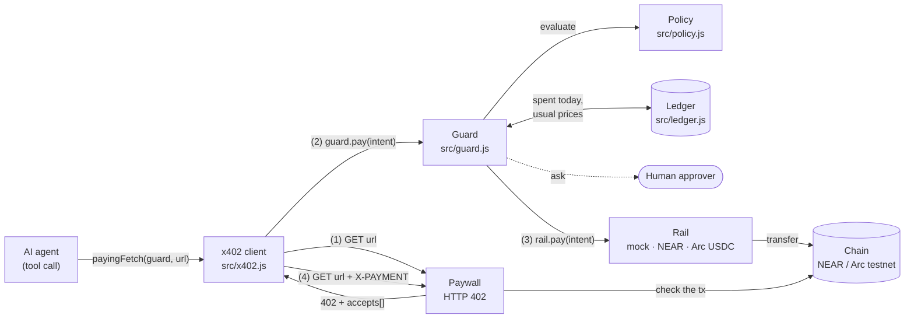
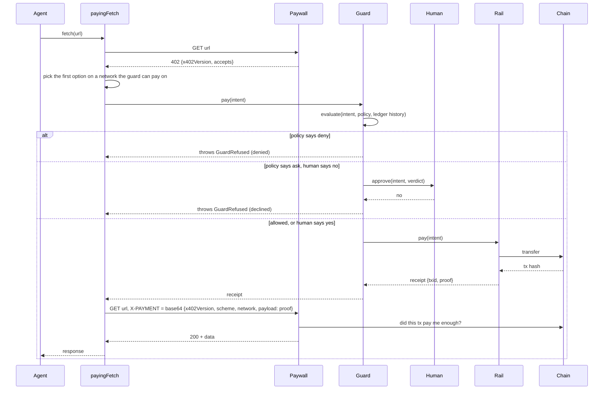

# Architecture

spend-guard sits between an AI agent and the wallets it pays from. The agent never calls a wallet. It fetches a URL, and when the server answers `402 Payment Required`, the guard decides whether to pay before any money moves.

## One paid request, step by step

Every outcome (`paid`, `denied`, `declined`, `failed`) is written to the ledger and emitted as an `entry` event. The live dashboard (`demo/dashboard.js`) listens to that event.

## Parts

| Part | File | Job |
|---|---|---|
| x402 client | `src/x402.js` | `payingFetch` turns a 402 answer into an intent, asks the guard to pay, and repeats the request with the proof in `X-PAYMENT`. Other responses pass through untouched. |
| Guard | `src/guard.js` | Runs one payment at a time: evaluates the policy, asks the human when the policy says so, pays through the rail for the intent's network, and records the outcome. |
| Policy | `src/policy.js` | `evaluate(intent, policy, history)` is a pure function that returns `allow`, `ask` or `deny` and every reason. See [policy.md](policy.md). |
| Ledger | `src/ledger.js` | Every decision, paid or not. Today's spend and each endpoint's usual price are read from it. Can also append JSON lines to a file. |
| Money | `src/money.js` | Converts atomic amounts to micro-dollars. Known assets and their decimals live in `ASSETS`. |
| Rails | `src/rails/*.js` | Move money on one network each. See [rails.md](rails.md). |

## Design choices

- **The policy is pure.** `evaluate` gets today's spend and the endpoint's recent prices as arguments. The same inputs always give the same verdict, so the rules are tested without a clock, a chain or a network.
- **No floating point decides a payment.** Amounts travel as bigint atomic units and every check compares integer micro-dollars (1e-6 USD).
- **A refusal explains itself in full.** All rules run and every one that fired is returned. The human sees the whole picture, not only the first problem.
- **Payments are serialized.** `Guard.pay` runs through a promise queue, so two parallel tool calls cannot both pass the daily budget check before either is recorded.
- **Rails are dumb.** A rail only moves money and returns proof. It holds no policy, and the guard is its only caller.
- **The paywall verifies on chain.** The demo paywall reads the transaction from the chain (`checkNearPayment`, `checkArcPayment`) and refuses a proof it has already accepted, so a forged or replayed proof gets nothing.

## Where the boundary is

The guard is a library that runs in the agent's process. It stops the model from paying badly through its tools. It does not stop other code in the same process from calling a rail or reading its key. Give the model `payingFetch` (or the MCP tool, in progress) and keep the rails and keys out of its reach. See [threat-model.md](threat-model.md).
