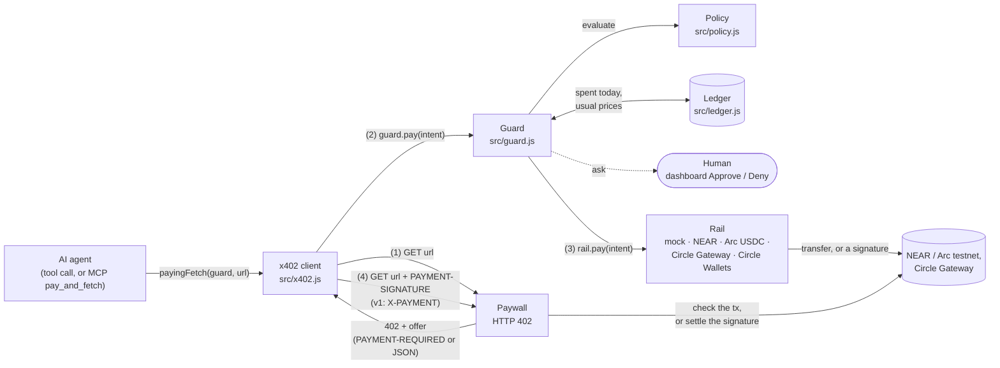
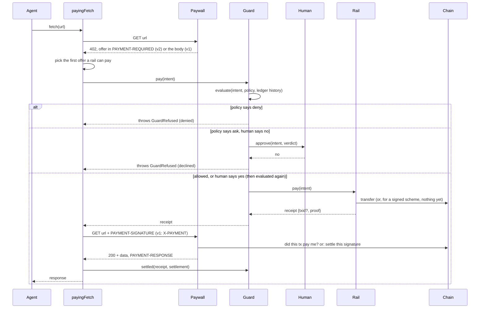

# Architecture

spend-guard sits between an AI agent and the wallets it pays from. The agent never calls a wallet. It fetches a URL, and when the server answers `402 Payment Required`, the guard decides whether to pay before any money moves or anything is signed.

## One paid request, step by step

Every outcome (`paid`, `unconfirmed`, `denied`, `declined`, `failed`) is written to the ledger and emitted as an `entry` event, and a paywall's settlement report as a `settled` event. The live dashboard (`demo/dashboard.js`) listens to both.

With a signed scheme (x402 `exact`, Circle Gateway) the rail sends nothing in step 3: it signs, and the paywall settles in step 4. The signature is the payment, so the guard has decided by then. Its settlement transaction arrives in `PAYMENT-RESPONSE` and is added to the entry.

## Parts

| Part | File | Job |
|---|---|---|
| x402 client | `src/x402.js` | `payingFetch` reads an x402 v2 or v1 offer, picks one a rail can pay, asks the guard, repeats the request with the payment, and records the settlement. Other responses pass through untouched, and it retries once at most. |
| Guard | `src/guard.js` | Evaluates the policy, asks the human when the policy says so, pays through the rail for the intent's network, and records the outcome. |
| Policy | `src/policy.js` | `evaluate(intent, policy, history)` is a pure function that returns `allow`, `ask` or `deny` and every reason. See [policy.md](policy.md). |
| Ledger | `src/ledger.js` | Every decision, paid or not. Today's spend and each endpoint's usual price are read from it. With a file, it appends JSON lines and reads back what other processes wrote. |
| Approvals | `src/approval.js` | The queue behind `approve`: each flagged payment waits for an explicit yes, and a no, a timeout or a withdrawn call declines it. |
| MCP server | `src/mcp.js`, `bin/spend-guard.js` | `spend-guard mcp` gives an MCP client `pay_and_fetch`, `spending_status` and `spending_policy`, and serves the dashboard for approvals. |
| Dashboard | `demo/dashboard.js` | Live page on localhost: the budget, every decision with its reasons and transaction link, and Approve and Deny for flagged payments. |
| Money | `src/money.js` | Converts atomic amounts to micro-dollars. Known assets and their decimals live in `ASSETS`. |
| Rails | `src/rails/*.js` | Move money on one network each, or sign for it. See [rails.md](rails.md). |

## Design choices

- **The policy is pure.** `evaluate` gets today's spend and the endpoint's recent prices as arguments. The same inputs always give the same verdict, so the rules are tested without a clock, a chain or a network.
- **No floating point decides a payment.** Amounts travel as bigint atomic units and every check compares integer micro-dollars (1e-6 USD).
- **A refusal explains itself in full.** All rules run and every one that fired is returned. The human sees the whole picture, not only the first problem.
- **Decisions are serialized.** Payments go through a promise queue, and with a ledger file through a lock file too, so two parallel tool calls, or two MCP servers, cannot both pass the daily budget check before either is recorded. A payment that waits for a human leaves the queue while it waits and is evaluated again after the yes.
- **Money that may have left counts as spent.** A transfer sent but not confirmed is `unconfirmed`, and a signature is `paid` when signed. Both count against the budget.
- **What happens after the money moves cannot undo the payment.** A ledger file that can't take the entry (a full disk, a read-only file) or a dashboard listener that throws only gets a warning: the payment stays `paid` and the agent gets what it paid for. The entry waits in memory, and with a ledger file nothing more is decided until the file has it, because the processes sharing the file would decide without it.
- **Rails are dumb.** A rail only moves money or signs, and returns proof. It holds no policy, and the guard is its only caller. A rail that signs pays the approved payee and amount, not the offer's.
- **The paywall verifies.** The demo paywalls read the transaction from the chain (`checkNearPayment`, `checkArcPayment`), or verify and settle the signature (`verifyAuthorization` and `settleAuthorization`, or Circle Gateway), so a made-up proof gets nothing. Each proof or nonce is taken once, before the check, so two copies sent at once buy one call. A transfer proof is not tied to who sends it, though: see the [known gaps](threat-model.md#known-gaps).

## Where the boundary is

The guard runs in the agent's process, or in the MCP server the agent talks to. It stops the model from paying badly through its tools. It does not stop other code in the same process from calling a rail or reading its key. Give the model `payingFetch` or the MCP server and keep the rails and keys out of its reach. See [threat-model.md](threat-model.md).
